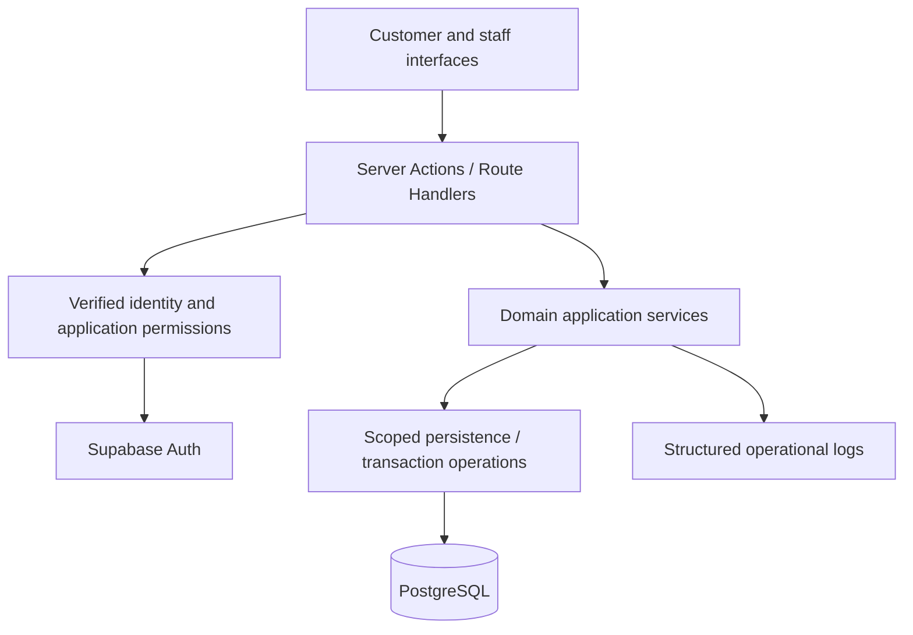

# Architecture

Status: ADR-001 through ADR-003 accepted; local end-to-end workflow implemented.
Updated: 21 October 2026. See [demonstration rules and limits](workflow.md).

## Shape

One Next.js application with feature-oriented server modules and PostgreSQL.
Reasons and alternatives are in [ADR-001](adr/001-modular-monolith.md).

BF-002 established the accepted baseline: Node.js runtime,
Drizzle with `pg`, local Supabase as one application/auth database, business
tables in non-exposed `app`, and separate runtime/migration privileges. The three
ADRs are accepted. BF-005 setup and privilege evidence are in [database.md](database.md).

Customer request/decision endpoints use their defined public or capability-based
access policy; they must not be treated as unrestricted staff entry points.

## Responsibilities

| Boundary | Responsibility |
| --- | --- |
| Interface | Presentation, accessible input, loading/error states and navigation |
| Server entry | Runtime validation, verified identity/capability, authorization and response mapping |
| Domain service | Business rules, state transitions, transaction ownership and orchestration |
| Persistence | Scoped reads/writes, explicit transaction participation, constraints and migrations |
| Infrastructure | Auth integration, configuration, database connections and safe logging |

Server-rendered reads need the same access rules as mutations. No alternate
entry point may bypass the domain operation or permission boundary. Keep server
database/auth secrets out of client bundles. Add files as behaviour needs them;
do not create generic repositories, service wrappers or empty module trees.

Feature boundaries: bookings, scheduling, customers/vehicles, work orders and
estimates. Shared auth/database infrastructure belongs outside domain modules.
Avoid duplicating business operations across Server Actions and HTTP handlers;
add an HTTP interface only when an actual consumer needs it.

## Transaction model

The application service owns each business transaction. Persistence operations
must use that same transaction connection; independent inner writes would break
atomicity.

For confirmation: verify actor, lock or conditionally claim the booking, recheck
state and business rules, allocate bay/technician, update booking and append the
audit event. Commit all or roll back all. The exclusion constraint is final
authority on allocation overlap. Read-before-write availability is insufficient.

Cancellation and rescheduling contend on the same booking state. Use consistent
resource ordering to reduce deadlocks. Classify expected conflicts separately
from timeouts, deadlocks and connection failures; define bounded retry semantics
only where safe. Preserve original allocations when rescheduling fails.

Estimate issue/decision operations similarly protect state/version changes and
audit records in one transaction. External messages do not belong inside a
database transaction. Notifications are not part of initial implementation.

## Authentication and database access

Accepted design: Supabase Auth verifies staff identity; active application staff membership
determines permissions; server-side Drizzle performs scoped business access in
an `app` schema outside the Data API's exposed schemas. Deny business-schema
access to API roles; use a non-owner server role with only required DML and a
separate migration role. Verify actual exposure/grants before relying on this.
Do not assume a direct PostgreSQL connection carries the signed-in user's RLS
context. Choose and verify runtime privileges and Data API exposure before schema
creation. See [security.md](security.md) and [ADR-003](adr/003-authentication.md).

## Migration and deployment boundaries

Accepted design: Drizzle owns application migration history, including reviewed SQL for
extensions and constraints. Supabase manages local platform/auth infrastructure.
BF-005 verifies the initial schema, extension and privilege baseline. Never create competing migration histories for
the same tables or alter platform-owned auth tables casually.

Choose the connection driver/pool mode against transaction requirements and the
actual deployment environment. Do not select runtime-incompatible APIs or make
session-level assumptions across pooled transactions.

Recommended driver: `pg` on the Node.js runtime. BF-003 establishes only the app
and unit-test baseline. BF-005 creates local infrastructure/migrations; BF-006
introduces workshop, staff and resource tables; BF-007 adds the first protected
resource read. Booking/allocation schema and services belong to BF-009.

The runtime is a five-connection `pg` pool with Drizzle transactions. The same
transaction owns actor checks, booking/work-order locks, scoped writes and audit.
Custom migrations enforce allocation exclusion/pair consistency and immutable
issued estimates. No deployment, background workers or separate services exist. Release review must
cover migration permissions, secrets, connection limits, rollback/recovery and
test isolation before any approved deployment.

## Observability

Record operation, safe identifiers, correlation ID, outcome and useful error
classification. Exclude tokens, credentials, request bodies and unnecessary PII.
Audit events are durable business history; operational logs do not replace them.
