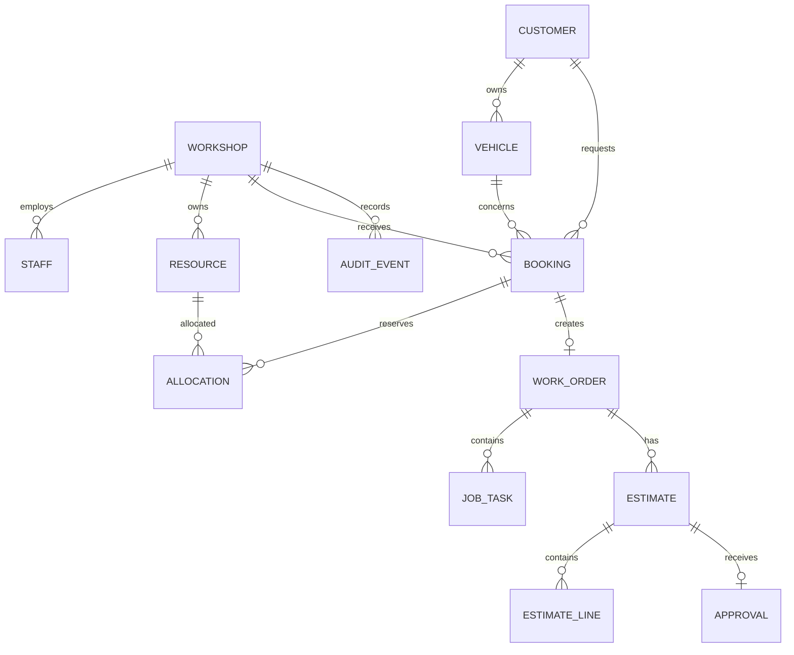

# Data model

Status: local workflow persistence implemented, 21 October 2026. The 14 tables are
declared in `scripts/db/schema.ts` and `scripts/db/workflow-schema.ts`. Reviewed
custom SQL adds scheduling and immutability guards. The accepted demonstration
rules and exact supported behaviour are in [workflow.md](workflow.md); broader
ownership-transfer and retention requirements remain unresolved for real use.

Ownership shown here is an initial simplification; contact/authorizer and vehicle
ownership-transfer semantics must be agreed before customer workflows.

## Entities and integrity requirements

| Entity | Important fields and constraints to design |
| --- | --- |
| Workshop | UUID, nonempty space-trimmed name, validated timezone |
| Staff | UUID, required workshop/auth-user UUIDs, manager/adviser/technician role, active flag; unique workshop/user membership |
| Resource | UUID, required workshop, bay/technician type, nonempty space-trimmed name, active flag, optional same-workshop staff link for technicians only; unique workshop/type/name and workshop/staff link |
| Customer | UUID, workshop ownership, required contact fields defined by workflow; no assumed global email uniqueness |
| Vehicle | UUID, customer/workshop relationship, registration and descriptive fields; define normalization/ownership changes |
| Booking | UUID, workshop, customer, vehicle, state and requested interval; related entities must belong together |
| Allocation | UUID, booking, resource, start/end instants, released timestamp; overlap exclusion for active rows |
| Work order | UUID, unique booking, state and audit metadata |
| Job task | UUID, work order, description and validated state |
| Estimate | UUID, work order, version, lifecycle, currency/tax/total snapshot, issue/expiry metadata; unique work-order/version |
| Estimate line | UUID, estimate, description, quantity, integer minor-unit amounts and explicit tax treatment |
| Approval | UUID, exact estimate version, decision, actor mechanism and decision time; at most one decision per version |
| Audit event | UUID, workshop, entity/action, actor and timestamp; typed entity references to be designed |

Audit events must represent booking and estimate events as well as work-order
events. Requiring a work-order ID for every event would prevent recording a
booking request before a work order exists. Decide reference constraints before
implementing the audit schema; do not use an unchecked generic entity ID by default.

## BF-006 persisted rules

`scripts/db/schema.ts` and versioned Drizzle SQL own the three `app` tables.
UUIDs default to PostgreSQL-generated values; staff/resources default active.
Workshop names need not be unique. Resource names are case-sensitive and unique
within workshop/type, including inactive rows. Multiple unlinked technician
resources are allowed; one membership can link at most one technician resource.
The same auth user can have one membership in each of several workshops.

A composite foreign key prevents cross-workshop staff/resource links on inserts
and updates. Bays cannot link staff. A technician resource may be unlinked;
staff authorization role is separate from schedulable capability, so the linked
member need not have the technician role. Active flags support retirement without
removing identity or resource history; they do not enforce scheduling eligibility.
Application permission and availability checks belong to later stages.

The timezone check accepts `UTC` and named zones/aliases in PostgreSQL's timezone
catalogue containing `/`, excluding `posix/` and `right/` namespaces. It rejects
abbreviations and unknown names; it does not canonicalize aliases. The initial
synthetic workshop uses `Europe/London`. DST input handling remains future work.

Staff references the actual platform-owned `auth.users(id)` UUID primary key.
Auth identity updates/deletes and workshop/staff key changes/deletes are restricted
when referenced. No cascades remove operational records. Deactivate staff/resources
instead of deleting them. Runtime has SELECT only; future authorized write paths
must explicitly introduce their needed grants and permission checks. Retention,
anonymization and authorized correction are still undefined.

## Scheduling constraints

- Allocation resource and booking belong to the same workshop. Use appropriate
  composite keys/foreign keys where necessary; independent foreign keys alone
  do not enforce this relationship.
- Non-null, finite endpoints and `start_at < end_at`; timezone-aware timestamps.
- Proposed exclusion: resource equality plus overlap of
  `tstzrange(start_at, end_at, '[)')`, limited to rows with `released_at IS NULL`.
- Verify `btree_gist` availability and the exact deployed PostgreSQL version.
  Review actual SQL rather than assuming the ORM emitted the constraint.
- Decide required-resource uniqueness per active booking. The overlap constraint
  alone does not prevent one booking being confirmed against different resources.
- Requests allocate nothing. Confirmation creates all required allocations and
  changes booking state with its audit event in one transaction.
- Release preserves history. Cancel/reschedule must not delete allocations just
  to free capacity. Failed replacement restores the prior state via rollback.
- Availability windows, absence exceptions and capability matching are additional
  rules; non-overlap alone does not prove an allocation is operationally valid.

## Time, money and versioning

Use workshop-local time for display/input and absolute instants for allocation.
PostgreSQL timezone-aware timestamps do not retain the workshop's IANA timezone;
store it separately. Specify DST ambiguity/nonexistence handling at the boundary.

Money uses integer minor units with currency. Validate quantities, numeric bounds,
tax and deterministic rounding. Issued/approved estimate lines and totals cannot
be edited; changes create a new version. Decision writes must atomically reject
superseded/expired versions and resolve duplicate submissions without creating
multiple authorizations. Design a database-supported immutability strategy before
claiming it is enforced.

## State, deletion and migrations

Domain services own permitted transitions. Constraints enforce valid values,
required relationships and critical uniqueness; they do not replace the service
state machine. Deliberate locking/conditional updates handle concurrent changes.

Initially restrict deletion of referenced operational history. Define retention,
anonymization and authorized correction separately; do not cascade-delete
approvals or audit history accidentally. Decide indexes from actual access paths.

Accepted migration owner: Drizzle. Version custom SQL alongside generated SQL.
Verify clean-database application, required constraints, privileges and supported
upgrade paths in disposable databases. No reset or production migration is
authorized by this document.
